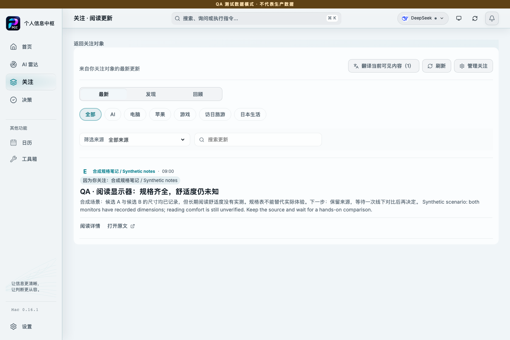
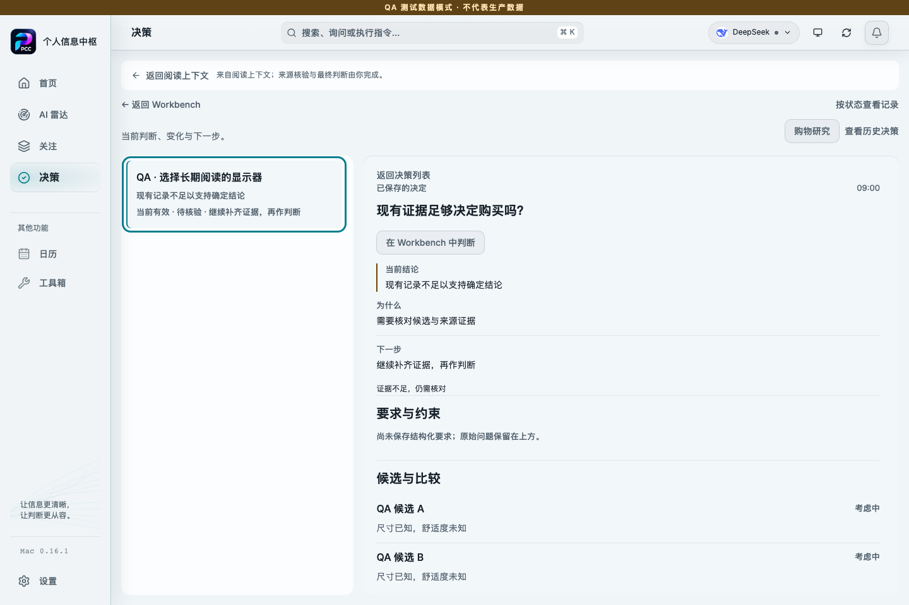
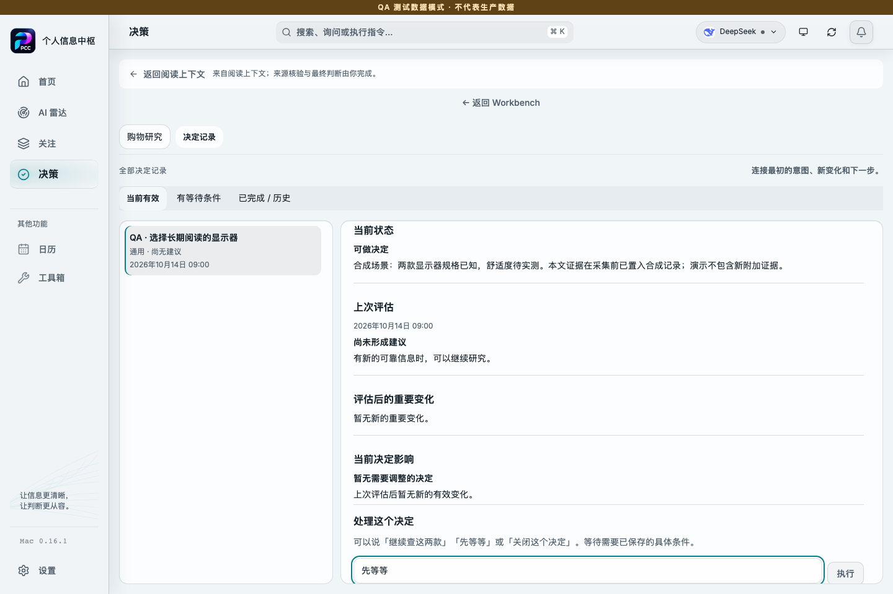
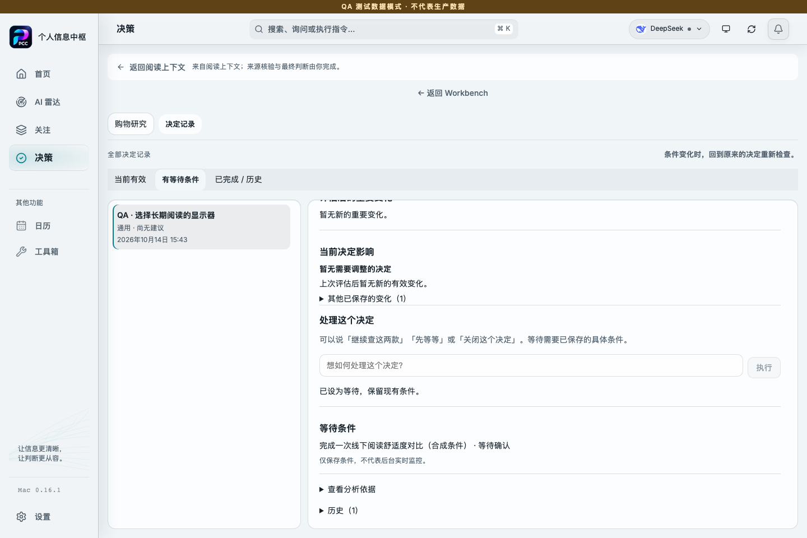
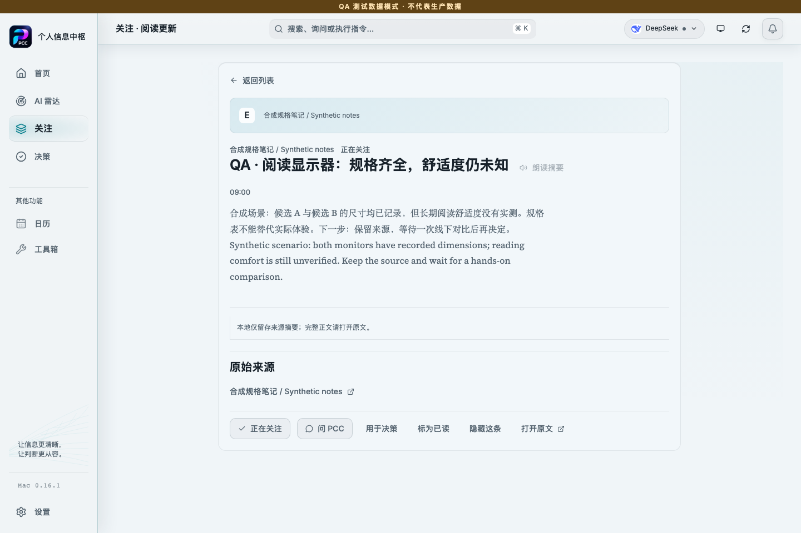
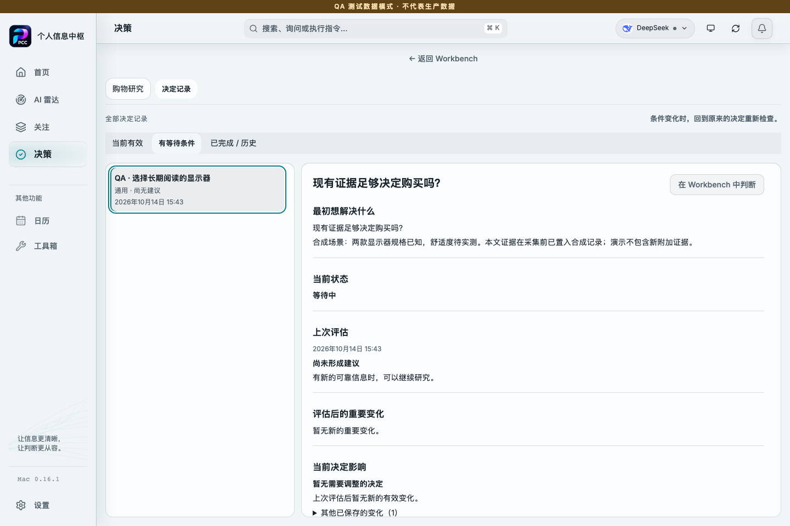

# PCC · two-minute synthetic walkthrough

**Scenario:** Should I buy one of two monitors for long reading sessions? Their dimensions are known; comfort is not. I read the note and explicitly choose to wait until a hands-on comparison.

This is a continuous, real capture of the **0.16.1 main frontend** on 14 October 2026. It uses PCC’s existing isolated browser QA mode, a fresh browser context, entirely synthetic records and a fictional `example.invalid` source. The QA banner is retained in every image. No UI pixels were reconstructed or retouched.

**What is demonstrated:** Reading continuity, navigation to a pre-seeded decision, explicit save through the existing browser gateway, return to the original article and persistence across a page reload. Article evidence and the waiting condition were prepared before capture. New evidence attachment, paid AI responses and native database writes are outside this demo.

**Development context:** PCC was developed with contributions from Claude Code and Codex. This walkthrough was prepared with Codex assistance from the existing frontend. It documents the rendered UI and browser-local storage behavior; the capture itself makes no AI-provider calls.

## 1. Review one source-backed update

The fictional note says that dimensions are known, but reading comfort remains unverified.

## 2. Read without losing the source

The full displayed excerpt, timestamp and fictional source stay visible. No remote article is fetched.

## 3. Open the same decision in context

“用于决策” (use for decision) → “打开所选决策” (open selected decision). This navigates to the pre-seeded record; it does not attach new evidence.

## 4. Choose the next action explicitly

In saved records, enter “先等等” (wait) with a specific condition already saved. Reading has not created a saved event.

## 5. Save the waiting action

Click “执行” (execute). PCC confirms “已设为等待，保留现有条件” (set to waiting; existing condition retained). Exactly one local saved event is recorded.

## 6. Return to the same article

“返回阅读上下文” (return to reading context) restores the same synthetic title.

## 7. Reopen after a page reload

The original question and WAITING state remain in saved records. This is real browser-local persistence, not native SQLite acceptance.

## Capture identity and scope

- Product version: 0.16.1; main source revision: `6488f743362dce6eae1893fd6170165db08b6486`.
- Capture: 14 October 2026, 06:43:13–06:43:17 UTC (15:43 JST); 1440 × 960, light theme.
- Runtime: existing Vite frontend and installed Chromium/Playwright, fresh temporary browser context. Only the declared QA fixture modules supplied custom synthetic records; product source and save implementation were unchanged.
- Storage: browser context localStorage; no native app, production account, database or credential store was opened. Remote browser requests were blocked; none were attempted in the completed run.
- Outcome: no automatic saved event during reading; one event after explicit execution; the waiting condition and article evidence remained; WAITING persisted after reload. No final purchase decision was invented.

The full desktop product is private. This walkthrough is visible behavior evidence for the scoped browser flow, not a public reproduction package for the native product. [Other evidence and limits](EVIDENCE.md).
