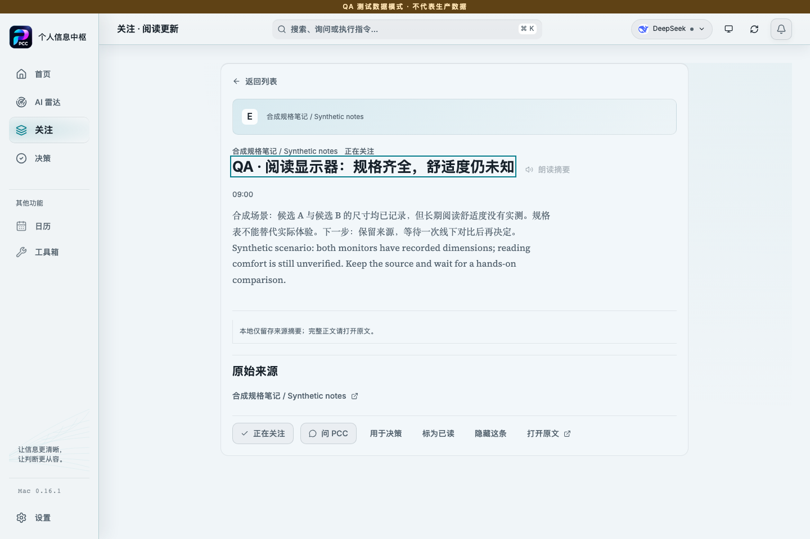
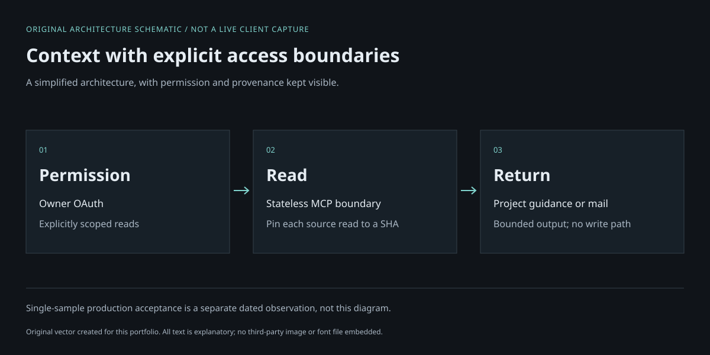
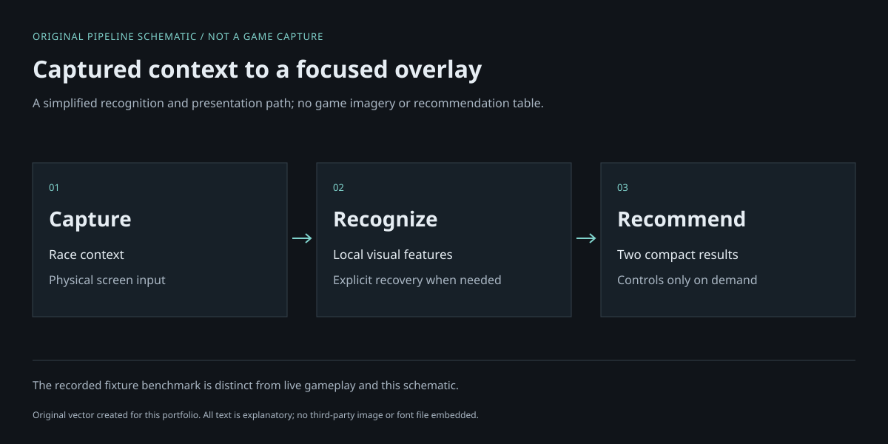

# Ethan · Tools for a clear next step

My background is hospitality partnerships and TravelTech operations in Japan. I turn everyday friction into tools I can use and inspect, own product direction and acceptance, and collaborate with Codex on implementation.

**Start with Personal Command Center.** In the walkthrough, two monitor candidates have known dimensions but unverified reading comfort. I read the source, keep the decision in context, and explicitly save “wait for a hands-on comparison.” The same record survives a page reload.

[Portfolio](https://ethan-wei-portfolio.ethanwei77.chatgpt.site) · [LinkedIn](https://www.linkedin.com/in/ethan-w-43a111238/)

[Two-minute PCC walkthrough](DEMO.md) · [Evidence and limits](EVIDENCE.md) · [Runnable cache example](https://github.com/yiyisann/evidence-cache-demo)

*Actual PCC 0.16.1 frontend, isolated browser QA, synthetic data. The screenshots are real captures; this is not an installed-native or AI-provider demonstration.*

## Personal Command Center · flagship

**Problem:** Information, reading and decisions are easy to separate into different tools, losing the source and the next action.

**My contribution:** I shaped the reading-and-decision workflow, cache continuity and explicit save boundary, then worked with Codex on implementation and installed-app acceptance.

**Implementation:** React/TypeScript, Tauri/Rust and SQLite in the desktop product. The walkthrough uses the existing browser QA gateway from the same 0.16.1 main revision.

**Result:** The real walkthrough shows reading → saved decision context → an explicit waiting action → return to the same article → persistence after reload. Reading alone creates no saved event. Separate installation records cover Mac 0.16.1 source, signature and bundle parity.

**Key limit:** Browser QA persistence does not verify native SQLite writes or new evidence attachment. Article evidence and a specific waiting condition were seeded before the walkthrough. Human voice accuracy, the current Windows release and trusted public distribution remain unqualified.

## Personal AI Control Plane · supporting project

**Problem:** AI context can become ambiguous about permission, which source is current, and whether a read changes the underlying account.

**My contribution:** I defined account and authority boundaries, worked with Codex on implementation, and separated deployed code identity from source identity.

**Implementation:** TypeScript, a stateless MCP service on Cloudflare Workers, owner OAuth, SHA-pinned source reads and a bounded read-only IMAP adapter.

**Result:** Production 1.0.0 was confirmed on 14 October 2026; list, search and message reads succeeded. One naturally unread message stayed unread through list → body read → list.

**Key limit:** Japanese subject search can miss matches; HTML-only messages may not yield plain text. The unread check is one sample, and its private production evidence is not publicly reproducible.

*Architecture schematic, not a client capture or a security proof. No mail content is included.*

## FH Overlay · supporting project

**Problem:** Captured race context and recommendations need to stay readable in one focused Windows surface.

**My contribution:** I shaped the focused overlay, recovery behavior and acceptance of the full F10-to-result path, collaborating with Codex on implementation and packaging.

**Implementation:** Python/Tk, local visual recognition and a recommendation policy.

**Result:** Source and packaged builds each completed 16/16 cases in a physical screenshot-fixture replay. Recorded F10 P95: 223.0 ms source / 260.2 ms packaged.

**Key limit:** These measurements are fixture replay, not natural live gameplay or a final installed-runtime benchmark. Raw per-case inputs and outputs are not published.

*Pipeline schematic, not a game capture or recognition result.*

## A small example you can run

[Evidence-cache demo](https://github.com/yiyisann/evidence-cache-demo) illustrates one rule: a failed refresh preserves the last useful fact and its observation time, while visibly marking it stale. Node.js 22+, no dependencies or network; run `node demo.mjs` and `node --test cache.test.mjs`.

It is an independent teaching example, not extracted product code. It does not prove PCC behavior, MCP authorization safety or recognition performance.

**Authorship and scope:** These existing projects are presented as work developed with Codex assistance, not Claude or Claude Code builds. Full product repositories and operational records remain private. See [visual sources and reuse scope](ASSETS.md).
